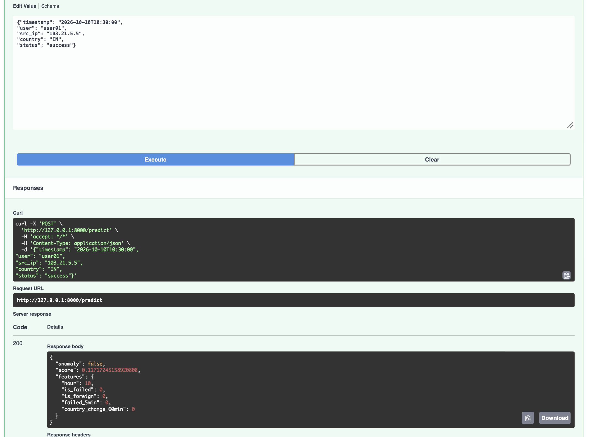
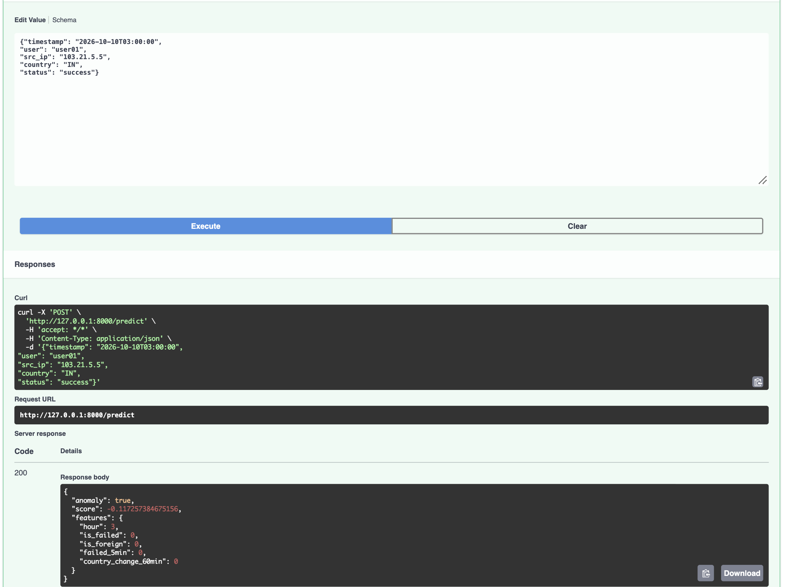

# security-log-anomaly-detector

ML-based anomaly detection for authentication logs using Isolation Forest, FastAPI, Spring Boot, Docker and the ELK stack.

> **Status:** work in progress.

## How it works

1. `generate_logs.py` creates synthetic authentication logs with injected anomalies: brute force, odd-hour logins and impossible travel.
2. `features.py` turns raw events into features such as hour of day, failed attempts in the last 5 minutes and country changes.
3. `train.py` trains an Isolation Forest without using labels. Labels are used only to evaluate the result.
4. `main.py` serves the model through a FastAPI `/predict` endpoint.

## Results

Evaluated on 2,935 synthetic events, 520 of them injected anomalies:

| Metric | Anomaly class |
|---|---|
| Precision | 0.85 |
| Recall | 0.86 |
| F1-score | 0.85 |

Overall accuracy is 0.95. Detection rate by type: brute force 85%, odd hour 100%, impossible travel 100%. About 3% of normal events are flagged by mistake.

Full report: [docs/results.txt](docs/results.txt)

**Note:** `contamination` was set close to the true anomaly rate of the synthetic data. With real logs the true rate is unknown, so the threshold would need tuning against a labeled sample or the team's alert capacity.

## Run the ML service

```bash
python3 -m venv .venv
source .venv/bin/activate
pip install -r ml-service/requirements.txt

python ml-service/app/generate_logs.py --days 30
python ml-service/app/train.py
uvicorn main:app --app-dir ml-service/app --reload
```

Open http://127.0.0.1:8000/docs for the interactive API docs.

## Example requests

Normal login (10:30 AM):



Suspicious login (3 AM):




## Tech stack

Python, scikit-learn, pandas, FastAPI. Planned: Spring Boot, Elasticsearch, Kibana, Docker Compose.

## Roadmap

- [x] Synthetic log generator
- [x] Feature engineering and Isolation Forest training
- [x] FastAPI prediction service
- [ ] Spring Boot REST API
- [ ] Elasticsearch and Kibana dashboard/alerts
- [ ] Docker Compose one-command startup
- [ ] Tests and CI
